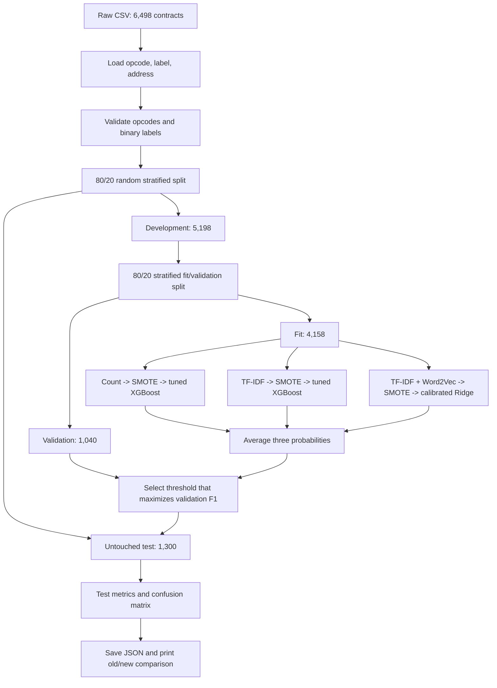

# Last Commit Progress Report

## 1. Commit identification

- **Commit:** `5ed8509613838f8e43268e075b58753f77c60e80` (`5ed8509`)
- **Author:** Haritha Sandaruwan
- **Date:** 14 October 2026, 12:32:27 (+05:30)
- **Title:** `feat: Update dataset audit and feature summary with new paths and metadata; add static random MulCas results script`
- **Scope:** five files changed, with 562 insertions and 11 deletions.

The commit adds a new static classification experiment intended to maximize
classification performance on the available dataset. It abandons chronological
evaluation for this experiment and instead uses a reproducible random stratified
split. The original paper-aligned results remain available as a reference and
are not overwritten.

## 2. Files changed

| File | Change | Purpose |
|---|---|---|
| `scripts/static_random_mulcas.py` | Added, 415 lines | Implements data loading, random splitting, feature extraction, SMOTE, model tuning, ensemble prediction, threshold selection, evaluation, result persistence, and old/new comparison. |
| `results/experiments/static_random_mulcas_results.json` | Added, 136 lines | Stores the completed experiment configuration, split counts, selected parameters, final metrics, confusion matrix, classification report, and comparison with prior results. |
| `results/baseline/dataset_audit.json` | Refreshed | Updates generation time, local repository path, and measured Python memory usage. Dataset hash and substantive dataset counts remain unchanged. |
| `results/baseline/paper_aligned/feature_summary.json` | Refreshed | Updates generation time and local dataset/artifact paths. |
| `results/baseline/paper_aligned/split_metadata.json` | Refreshed | Updates generation time and the local dataset path. The chronological boundaries and counts are unchanged. |

## 3. Objective and motivation

The previous paper-aligned experiment evaluates later-created contracts using a
strict chronological split. That protocol is useful for measuring temporal
generalization and concept drift, but the final test recall was only 45.31% and
the Ponzi-class F1 score was 60.42%.

The new experiment answers a different question: how accurately can the
available labeled collection be classified when treated as a conventional
static binary-classification dataset? It therefore uses random stratified
sampling, training-only oversampling, model tuning, probability ensembling, and
validation-based threshold selection.

This distinction is essential. The new result measures performance on a random
sample from the same overall dataset distribution. It does not measure the
ability to predict future contracts under concept drift.

## 4. Dataset

### 4.1 Source

- **Input file:** `data/raw/PonziDataset_20221114.csv`
- **CSV size:** 307,176,676 bytes
- **SHA-256:** `48b13eab1f87c68b3e486f5932df22c7907e76bd23b4042de8d0b2a83ce846cf`
- **Total rows:** 6,498
- **Benign contracts:** 6,184 (95.17%)
- **Ponzi contracts:** 314 (4.83%)
- **Approximate class ratio:** 19.69 benign contracts for every Ponzi contract

The audited row and Ponzi counts exactly match the published reference counts.
There are no null values in the ten audited columns, and labels contain only 0
and 1.

### 4.2 Columns used by the new experiment

The script reads only:

- `opcode`: the static opcode sequence used for feature extraction;
- `label`: 0 for benign and 1 for Ponzi;
- `address`: used to audit address overlap between train and test.

The experiment deliberately ignores `createdBlockNumber`, `timestamp`, source
code fields, creator identity, and transaction identifiers. It does not use
transaction behavior or post-deployment activity.

### 4.3 Duplicate information

The dataset audit records:

- 30 duplicate addresses;
- 197 duplicate transaction hashes;
- 712 rows whose opcode sequence exactly duplicates another row;
- 195 exact duplicate-opcode groups.

The random split placed three contract addresses in both the training and test
sets. This is reported by the script and is a potential source of optimistic
test performance.

## 5. Splitting method and counts

The experiment uses `StratifiedShuffleSplit` with seed 42 for the outer split:

- 80% development/training partition;
- 20% final test partition.

The 80% development partition is divided again with stratification and seed 43:

- 80% model-fit partition;
- 20% validation partition.

Relative to the entire dataset, this produces 64% fit, 16% validation, and 20%
test data.

| Partition | Rows | Ponzi | Benign | Dataset share | Ponzi prevalence |
|---|---:|---:|---:|---:|---:|
| Development/train | 5,198 | 251 | 4,947 | 79.99% | 4.83% |
| Model fit | 4,158 | 201 | 3,957 | 63.99% | 4.83% |
| Validation | 1,040 | 50 | 990 | 16.01% | 4.81% |
| Final test | 1,300 | 63 | 1,237 | 20.01% | 4.85% |

The test set is not used for hyperparameter selection or threshold selection.
The final models are fitted on the 4,158-row fit partition; the script does not
refit them on the complete 5,198-row development partition after threshold
selection.

## 6. Input validation and preprocessing

The script performs the following checks and transformations:

1. Reads only the required CSV columns to reduce memory use.
2. Converts missing opcode values to empty strings and then rejects any empty
   opcode sequence.
3. Converts labels to integer values and rejects labels outside `{0, 1}`.
4. Splits opcode documents on whitespace while preserving opcode case.
5. Fits every vocabulary, IDF calculation, Word2Vec model, SMOTE operation, and
   estimator only inside its applicable training fold.
6. Leaves validation and test rows at their natural imbalanced distribution.

There is no general numeric scaling because the primary representations are
sparse count or TF-IDF matrices. The dense Word2Vec representation is normalized
before it is combined with TF-IDF for the Ridge viewer.

## 7. Selected features

### 7.1 Feature A: opcode term counts

- `CountVectorizer`
- unigram range `(1, 1)`
- whitespace opcode tokenization
- case preserved
- minimum document frequency `2`
- maximum features `20,000`
- `float32` output

This view captures how frequently each individual opcode appears in a contract.

### 7.2 Feature B: opcode n-gram TF-IDF

- `TfidfVectorizer`
- n-gram range `(1, 3)`
- whitespace opcode tokenization
- case preserved
- minimum document frequency `2`
- maximum features `20,000`
- `float32` output

This view captures individual opcodes and local sequences of two or three
opcodes, while reducing the weight of patterns common across many contracts.

### 7.3 Feature C: mean-pooled Word2Vec

- embedding dimension: 64
- context window: 5
- minimum token count: 1
- epochs: 5
- workers: 1
- seed: 42
- aggregation: arithmetic mean of in-vocabulary opcode vectors
- post-processing: vector normalization

Word2Vec is trained from the applicable training rows. Unknown tokens are
ignored, and a document with no known tokens receives a zero vector.

Feature C is not used as an independent fourth model. It is joined with the
TF-IDF view through `FeatureUnion` and supplied to the Ridge viewer.

## 8. Class-imbalance handling

The fit partition has approximately 19.69 benign samples per Ponzi sample.
`SMOTE(k_neighbors=5, random_state=42)` is therefore placed inside each
imbalanced-learn model pipeline.

This placement is significant: during cross-validation and calibration, SMOTE
is fitted only on the current training fold. Synthetic samples are never created
from validation or test observations. This avoids the common leakage error of
running SMOTE before data splitting or before cross-validation.

XGBoost uses `scale_pos_weight=1.0`. The value was not included in the grid
search because SMOTE was used to balance model-fitting data.

## 9. Models and algorithms

### 9.1 Viewer 1: XGBoost with term counts

Pipeline:

`CountVectorizer -> SMOTE -> XGBClassifier`

Selected parameters:

- learning rate: 0.1
- maximum tree depth: 5
- estimators: 100
- objective: binary logistic
- evaluation metric during fitting: log loss
- tree method: histogram
- cross-validation F1: 75.19%

### 9.2 Viewer 2: XGBoost with n-gram TF-IDF

Pipeline:

`TF-IDF(1-3 grams) -> SMOTE -> XGBClassifier`

Selected parameters:

- learning rate: 0.1
- maximum tree depth: 3
- estimators: 100
- objective: binary logistic
- evaluation metric during fitting: log loss
- tree method: histogram
- cross-validation F1: 77.91%

### 9.3 Viewer 3: calibrated Ridge with TF-IDF and Word2Vec

Pipeline:

`TF-IDF + normalized mean Word2Vec -> SMOTE -> RidgeClassifier -> sigmoid calibration`

The Ridge regularization parameter is `alpha=1.0`. Because `RidgeClassifier`
does not produce probabilities directly, `CalibratedClassifierCV` uses sigmoid
calibration with three stratified folds.

### 9.4 Hyperparameter search

Each XGBoost viewer evaluates:

- maximum depth: 3, 5, 7;
- learning rate: 0.01, 0.1;
- estimators: 100, 200.

This gives 12 candidates per viewer. Three-fold stratified cross-validation
produces 36 fits per viewer and 72 XGBoost fits in total. Candidates are ranked
by Ponzi-class F1, and the best candidate is refitted on the complete fit
partition.

## 10. Ensemble and threshold selection

The three fitted viewers return Ponzi-class probabilities. The ensemble score is
their equal-weight arithmetic mean:

`(count XGBoost + TF-IDF XGBoost + calibrated Ridge) / 3`

The validation precision-recall curve is evaluated across all available score
thresholds. The threshold with the greatest validation F1 is selected; if
multiple thresholds have effectively equal maximum F1, the highest threshold is
used.

- **Selected threshold:** 0.39088033297408625
- **Validation F1 at the selected threshold:** 88.24%

The threshold is frozen before final test evaluation.

This implementation is described as **MulCas-style**. It uses multiple feature
views, but it is not the original MulCas residual cascade. It performs
equal-weight soft voting rather than confidence-based cascade routing.

## 11. End-to-end flow



## 12. Final results

### 12.1 Confusion matrix

| Actual/predicted outcome | Count |
|---|---:|
| True negatives | 1,230 |
| False positives | 7 |
| False negatives | 10 |
| True positives | 53 |

The model detected 53 of the 63 Ponzi contracts in the test set and missed 10.
It incorrectly flagged 7 of the 1,237 benign test contracts.

### 12.2 Test metrics

| Metric | Result |
|---|---:|
| Accuracy | 98.69% |
| Balanced accuracy | 91.78% |
| Ponzi precision | 88.33% |
| Ponzi recall | 84.13% |
| Ponzi F1 | 86.18% |
| Trapezoidal precision-recall AUC | 88.37% |
| Average precision | 88.33% |
| Benign F1 | 99.31% |
| Macro F1 | 92.75% |
| Weighted F1 | 98.68% |

Average precision is used as `PR-AUC` in the old/new comparison because the
existing baseline evaluation uses `average_precision_score`. The result file
also retains the trapezoidal precision-recall AUC as a separate value.

## 13. Comparison with references

| Result | Accuracy | Balanced accuracy | Precision | Recall | F1 | PR-AUC/AP |
|---|---:|---:|---:|---:|---:|---:|
| Published MulCas | Not reported | Not reported | 95.10% | 67.40% | 78.90% | Not reported |
| Old paper-aligned test | 92.53% | 72.32% | 90.63% | 45.31% | 60.42% | 66.24% |
| New random-split test | 98.69% | 91.78% | 88.33% | 84.13% | 86.18% | 88.33% |

Compared with the old local paper-aligned test, the new result changes by:

- accuracy: +6.16 percentage points;
- balanced accuracy: +19.46 points;
- precision: -2.29 points;
- recall: +38.81 points;
- F1: +25.76 points;
- average precision: +22.09 points.

Compared numerically with the published MulCas result, the new experiment has
7.28 points higher F1 and 16.73 points higher recall, with 6.77 points lower
precision. This is a descriptive comparison, not a controlled superiority
claim, because the evaluation protocols differ.

## 14. Final outcome

The commit successfully establishes a reproducible static-classification
experiment that substantially improves minority-class recall and F1 relative to
the local chronological baseline. The saved experiment detects 84.13% of Ponzi
contracts while keeping precision at 88.33%.

The result supports this conclusion:

> For randomly sampled contracts from the available dataset, training-only
> SMOTE, tuned multi-view models, calibrated soft voting, and validation-based
> threshold selection produce strong Ponzi classification performance.

The result does not support this stronger conclusion:

> The new method is proven to outperform published MulCas on future unseen
> Ethereum contracts.

That claim would require identical evaluation data and protocol, preferably
with grouped and repeated testing.

## 15. Testing and validation evidence

### 15.1 Controls implemented in the script

- Fixed random seeds for splits, SMOTE, XGBoost, cross-validation, and Word2Vec.
- Word2Vec uses one worker to improve repeatability.
- Stratification preserves minority prevalence across partitions.
- Feature fitting and SMOTE occur inside training/CV pipelines.
- Validation selects the decision threshold.
- Test labels are used only for final reporting.
- Address overlap is measured and reported.
- Result JSON includes split counts, parameters, metrics, and comparisons.
- `--show-comparison-only` reproduces the report without retraining.

### 15.2 Checks performed after reviewing the commit

- Python compilation check: passed.
- Saved comparison command: passed.
- Existing data-validation and evaluation-metric tests: 9 passed.
- Result-integrity assertions: passed.
  - split rows sum to 6,498;
  - fit plus validation equals the development partition;
  - confusion-matrix cells sum to 1,300 test rows;
  - positive test support equals 63;
  - stored accuracy matches `(TP + TN) / test rows`.

### 15.3 Automated-test gap

The commit adds no dedicated test module for `static_random_mulcas.py`. The
existing test suite therefore does not directly protect its split logic,
fold-local SMOTE behavior, threshold selection, probability averaging, result
schema, or comparison formatting from regression.

## 16. Environment observed during validation

The current virtual environment contains:

| Package | Version |
|---|---:|
| NumPy | 2.4.6 |
| pandas | 3.0.6 |
| SciPy | 1.17.1 |
| scikit-learn | 1.9.1 |
| XGBoost | 3.2.0 |
| imbalanced-learn | 0.14.2 |
| gensim | 4.4.0 |

These versions are not recorded inside the result JSON, so exact future
reproduction depends on preserving or recording the environment separately.

## 17. Limitations and known issues

1. **Evaluation protocol changed.** Much of the improvement may come from the
   easier random split rather than solely from a better classifier.
2. **Duplicate leakage risk.** Three addresses cross the train/test boundary,
   and many opcode sequences are duplicated. Row-level stratification does not
   keep contract families or duplicate groups together.
3. **Single split and seed.** The reported result is one realization with seed
   42. It does not quantify variance or confidence intervals.
4. **Small positive test sample.** Only 63 Ponzi contracts determine recall and
   F1. A change of one prediction moves recall by about 1.59 percentage points.
5. **Validation threshold may be unstable.** Only 50 validation positives are
   used to choose the threshold.
6. **No final refit.** Models are not retrained on fit plus validation data after
   model and threshold selection.
7. **Equal ensemble weights.** The three probabilities are averaged without
   learning weights or comparing alternative combination rules.
8. **Word2Vec is bundled with Ridge.** Its independent contribution cannot be
   inferred from the final result without an ablation.
9. **SMOTE on sparse text features.** Synthetic interpolations in count/TF-IDF
   space may not correspond to real opcode documents, even if they help the
   classifier.
10. **`scale_pos_weight` is not tuned.** It remains 1.0 because SMOTE is used.
11. **High accuracy is class-sensitive.** A benign-majority dataset can produce
    high accuracy, so balanced accuracy, Ponzi recall, F1, and average precision
    are more informative.
12. **No saved fitted models.** The script saves metrics but not vectorizers,
    Word2Vec state, estimators, or the selected ensemble as deployable artifacts.
13. **No runtime or resource record.** Training duration, peak memory, CPU
    details, and per-model inference time are not stored.
14. **No package snapshot in results.** Library changes could affect later
    reproduction.
15. **Published comparison is not like-for-like.** The published values and the
    local experiments use different splits and potentially different feature
    and software details.

## 18. Recommended next steps

1. Deduplicate or group by address and exact opcode hash before splitting.
2. Repeat the experiment over multiple fixed seeds and report mean, standard
   deviation, and confidence intervals.
3. Add ablations for SMOTE, Word2Vec, threshold optimization, each viewer, and
   soft voting.
4. Compare SMOTE with class weighting and tune `scale_pos_weight` in a separate
   controlled experiment.
5. Tune or learn ensemble weights using validation predictions.
6. Add dedicated unit tests for the new script's split, leakage controls,
   threshold calculation, evaluation arithmetic, and JSON schema.
7. Save package versions and run metadata with every experiment.
8. Persist the final trained pipeline if deployment or repeat inference is a
   project objective.
9. Retain chronological evaluation as a separate robustness test so static
   classification performance and future-contract generalization are both
   reported honestly.

## 19. Running and inspecting the experiment

Run full training from the repository root:

```powershell
.\.venv\Scripts\Activate.ps1
python scripts\static_random_mulcas.py
```

Display the saved old/new comparison without retraining:

```powershell
python scripts\static_random_mulcas.py --show-comparison-only
```

The machine-readable output is stored at:

`results/experiments/static_random_mulcas_results.json`

## 20. Conclusion

The latest commit adds a complete, leakage-conscious static opcode
classification experiment and records a strong result: 98.69% accuracy, 91.78%
balanced accuracy, 84.13% Ponzi recall, and 86.18% Ponzi F1. The most valuable
improvement is the large reduction in missed Ponzi contracts, from 35 false
negatives in the old 509-row paper-aligned test to 10 false negatives in the new
1,300-row random test.

The experiment is a useful performance-oriented extension of the project. Its
main research limitation is comparability: the random split removes the temporal
generalization challenge that caused the earlier score reduction. The result
should therefore be presented as strong in-distribution static classification,
with chronological performance retained as evidence about concept drift and
realistic future-contract robustness.